# ambientCG: Fabric materials

**21 assets from [ambientCG](https://ambientcg.com), dedicated to the public domain under [CC0](https://docs.ambientcg.com/license/).** Use them in any game, free or paid, and change them however you like; no credit is needed.

PBR materials as 1K and 2K JPG maps (colour, normal GL and DX, roughness, AO, displacement), one folder per resolution. 866.3 MB in all.

This is a copy kept by [zuujis-cc0](https://github.com/zuujis-cc0) so game makers can take single files from GitHub. It is not made by or affiliated with ambientCG: the originals, often in more formats and higher resolutions, are on [ambientcg.com](https://ambientcg.com). If they help you, consider [supporting ambientCG](https://www.patreon.com/ambientCG).

Every file is listed in [MANIFEST.tsv](MANIFEST.tsv) with its size and SHA-256. More free assets: [the Zuujis collection](https://github.com/zuujis-cc0/free-game-assets#readme).

| | | | |
| :-: | :-: | :-: | :-: |
| <a href="Fabric051">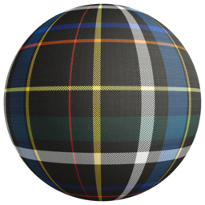</a> <b><a href="Fabric051">Fabric 051</a></b> by ambientCG · <a href="https://ambientcg.com/a/Fabric051">source</a> | <a href="Fabric052">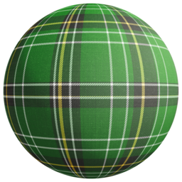</a> <b><a href="Fabric052">Fabric 052</a></b> by ambientCG · <a href="https://ambientcg.com/a/Fabric052">source</a> | <a href="Fabric053">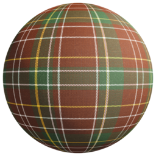</a> <b><a href="Fabric053">Fabric 053</a></b> by ambientCG · <a href="https://ambientcg.com/a/Fabric053">source</a> | <a href="Fabric054">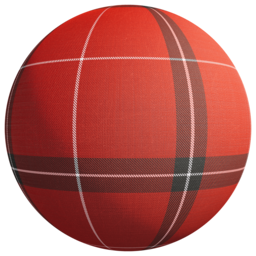</a> <b><a href="Fabric054">Fabric 054</a></b> by ambientCG · <a href="https://ambientcg.com/a/Fabric054">source</a> |
| <a href="Fabric055">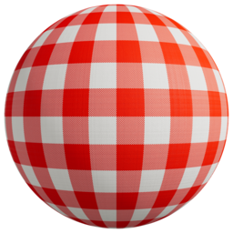</a> <b><a href="Fabric055">Fabric 055</a></b> by ambientCG · <a href="https://ambientcg.com/a/Fabric055">source</a> | <a href="Fabric056">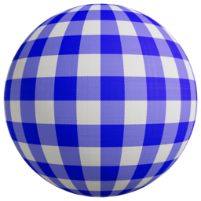</a> <b><a href="Fabric056">Fabric 056</a></b> by ambientCG · <a href="https://ambientcg.com/a/Fabric056">source</a> | <a href="Fabric057">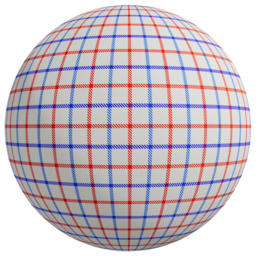</a> <b><a href="Fabric057">Fabric 057</a></b> by ambientCG · <a href="https://ambientcg.com/a/Fabric057">source</a> | <a href="Fabric058">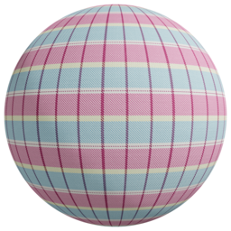</a> <b><a href="Fabric058">Fabric 058</a></b> by ambientCG · <a href="https://ambientcg.com/a/Fabric058">source</a> |
| <a href="Fabric059">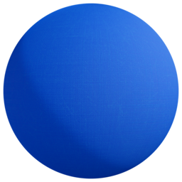</a> <b><a href="Fabric059">Fabric 059</a></b> by ambientCG · <a href="https://ambientcg.com/a/Fabric059">source</a> | <a href="Fabric060">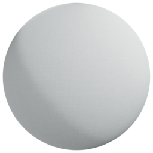</a> <b><a href="Fabric060">Fabric 060</a></b> by ambientCG · <a href="https://ambientcg.com/a/Fabric060">source</a> | <a href="Fabric061">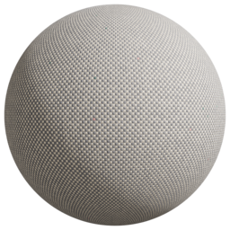</a> <b><a href="Fabric061">Fabric 061</a></b> by ambientCG · <a href="https://ambientcg.com/a/Fabric061">source</a> | <a href="Fabric062">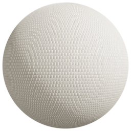</a> <b><a href="Fabric062">Fabric 062</a></b> by ambientCG · <a href="https://ambientcg.com/a/Fabric062">source</a> |
| <a href="Fabric063">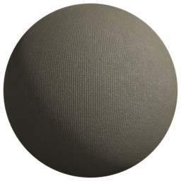</a> <b><a href="Fabric063">Fabric 063</a></b> by ambientCG · <a href="https://ambientcg.com/a/Fabric063">source</a> | <a href="Fabric064">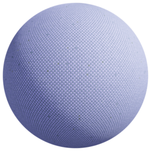</a> <b><a href="Fabric064">Fabric 064</a></b> by ambientCG · <a href="https://ambientcg.com/a/Fabric064">source</a> | <a href="Fabric065">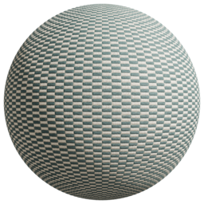</a> <b><a href="Fabric065">Fabric 065</a></b> by ambientCG · <a href="https://ambientcg.com/a/Fabric065">source</a> | <a href="Fabric066">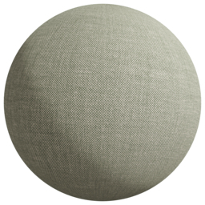</a> <b><a href="Fabric066">Fabric 066</a></b> by ambientCG · <a href="https://ambientcg.com/a/Fabric066">source</a> |
| <a href="Fabric067">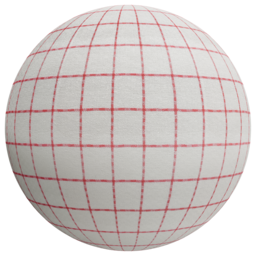</a> <b><a href="Fabric067">Fabric 067</a></b> by ambientCG · <a href="https://ambientcg.com/a/Fabric067">source</a> | <a href="Fabric068">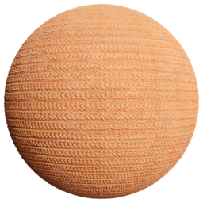</a> <b><a href="Fabric068">Fabric 068</a></b> by ambientCG · <a href="https://ambientcg.com/a/Fabric068">source</a> | <a href="Fabric069">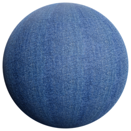</a> <b><a href="Fabric069">Fabric 069</a></b> by ambientCG · <a href="https://ambientcg.com/a/Fabric069">source</a> | <a href="Fabric070">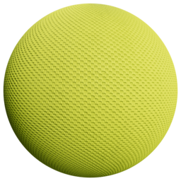</a> <b><a href="Fabric070">Fabric 070</a></b> by ambientCG · <a href="https://ambientcg.com/a/Fabric070">source</a> |
| <a href="Fabric071">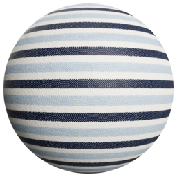</a> <b><a href="Fabric071">Fabric 071</a></b> by ambientCG · <a href="https://ambientcg.com/a/Fabric071">source</a> |  |  |  |

---

Kept up to date by this repository's own [update workflow](.github/workflows/update.yml), with code and plan from [cc0-mirror](https://github.com/zuujis-cc0/cc0-mirror). Something wrong? [Open an issue there](https://github.com/zuujis-cc0/cc0-mirror/issues/new) or use the [private report form](https://games.zuujis.com/report).
